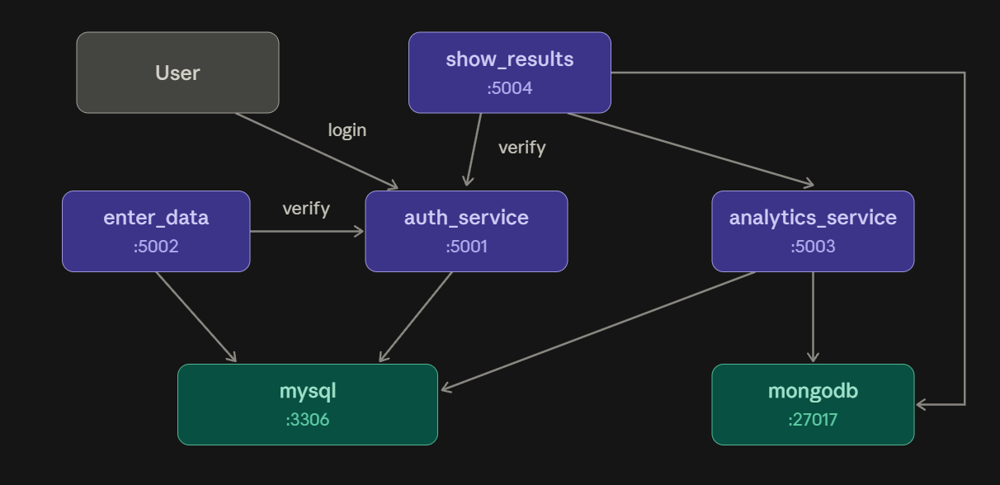

# 3495 - Project 1

### Basic Data Collection and Analytics System

## Overview

This project is a Docker Compose application made up of four application services and two databases. Users can authenticate, enter data, and view calculated analytics results.

## Architecture

The application contains four application services and two databases:

| Component | Purpose | Port |
|---|---|---:|
| `auth_service` | Flask authentication and JWT tokens | 5001 |
| `enter_data` | Node.js interface for entering data | 5002 |
| `analytics_service` | Calculates analytics using stored height data | 5003 |
| `show_results` | Displays analytics results | 5004 |
| `mysql_db` | Stores user accounts and collected data | 3306 |
| `mongo_db` | Stores computed analytics results | 27017 |

The four application services handle authentication, data entry, analytics, and results display. MySQL and MongoDB provide data storage.

The services communicate over the Docker Compose network. JWT authentication is used to protect analytics requests. The authentication and analytics services must use the same `JWT_SECRET_KEY`.

## Prerequisites

Install:
- Docker Desktop
- Docker Compose (included with current Docker Desktop versions)

## Configuration

1. Open the project root directory.
2. Create a `.env` file using the environment variables required by your Compose configuration.
3. Configure the MySQL credentials, database name, MongoDB URI, and `JWT_SECRET_KEY`.
4. Ensure the same `JWT_SECRET_KEY` is passed to both `auth_service` and `analytics_service`.

Keep `.env` out of version control. Do not commit passwords, JWT secrets, or other credentials.

## Deployment

Run these commands from the directory containing `docker-compose.yml`.

### 1. Build and start the application

```bash
docker compose up -d --build
```

### 2. Check service status

```bash
docker compose ps
```

Wait until the services report healthy, where health checks are configured.

### 3. Check logs if a service fails

```bash
docker compose logs --tail=100
```

To inspect an individual service:

```bash
docker compose logs --tail=100 auth_service
docker compose logs --tail=100 analytics_service
docker compose logs --tail=100 show_results
```

### 4. Access the application

- **Authentication Service (port 5001):** http://localhost:5001  
  Displays `Auth Service is running! Available routes: /register, /login, /protected`.

- **Enter Data (port 5002):** http://localhost:5002  
  Provides the interface for entering data.

- **Analytics Service (port 5003):** http://localhost:5003  
  Displays `Analytic Service is running! Available routes: /compute_analytics`.

- **Results Page (port 5004):** http://localhost:5004  
  Displays the analytics results.

Login through `/login` path and follow the application's workflow to enter data and view results.

Health endpoints are available at `/health` on the services that implement them.

### 5. Stop the application

```bash
docker compose down
```

This stops and removes the containers and Compose network. Named database volumes, if configured, are normally retained.

To remove database volumes as well, use `docker compose down -v`. **Warning:** this can permanently delete stored database data.

## Docker optimization

The `auth_service` uses a multi-stage Dockerfile, a Python virtual environment, a slim runtime image, and a non-root application user. Its measured image disk usage decreased from 1.56 GB to 266 MB, approximately an 83% reduction.

A `.dockerignore` file excludes unnecessary files from the build context, including `.env`, Python cache files, and local virtual environments.

## Multiarchitecture support

The Python and Node.js base images used by the project provide ARM64 and AMD64 variants. To distribute a single image that supports both architectures, build and publish it using Docker Buildx with `linux/amd64` and `linux/arm64` platforms.

## Basic Visual Diagram



**Description**
Each component is running in its own Docker container. A user logs in through auth_service (:5001), which issues an access token. enter_data (:5002) and show_results (:5004) both require that token, and the “verify” arrows show this requirement: those two services can’t be accessed without a valid token from auth_service.

Submitted data from enter_data is stored in MySQL, which auth_service also uses for user records. analytics_service (:5003) reads the data from MySQL, calculates the results, and saves them to MongoDB. show_results then reads from MongoDB and calls analytics_service to display the results to the user.

## Troubleshooting

- **HTTP 401:** Check that the request includes a valid JWT and that the services use the same `JWT_SECRET_KEY`.
- **HTTP 500:** Inspect the logs for the service handling the failed request.
- **Database connection errors:** Check database health, environment variables, and service names in `docker-compose.yml`.
- **Service not ready:** Run `docker compose ps` and inspect its logs before restarting it.
